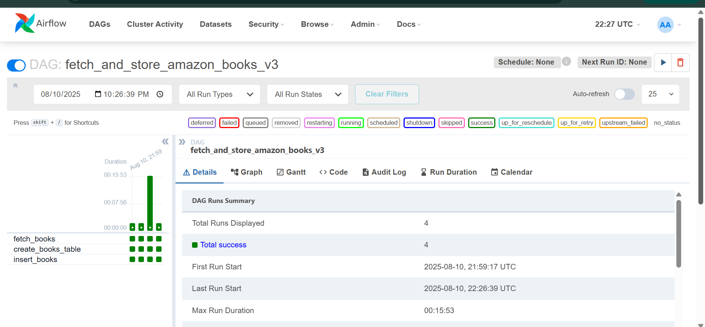
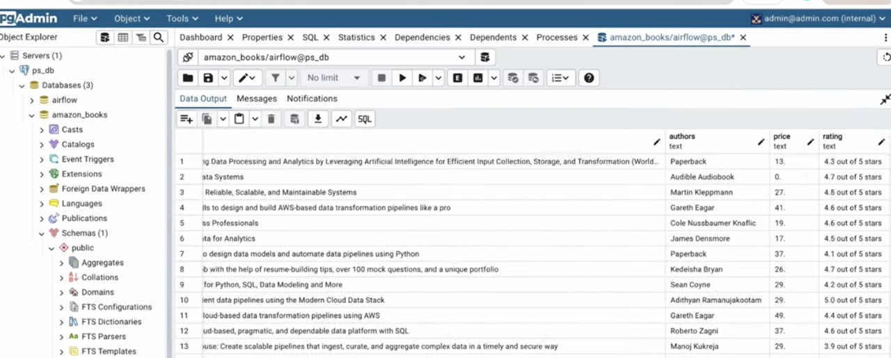

# Amazon Books ETL Pipeline (Apache Airflow + PostgreSQL)

An ETL pipeline orchestrated with **Apache Airflow** that scrapes book listings from Amazon search results, then creates a **PostgreSQL** table and loads the data into it. The pipeline runs in Docker with Airflow and pgAdmin.

## Pipeline Design


The DAG `fetch_and_store_amazon_books_v3` ([dags/app.py](dags/app.py)) runs three tasks in order:

| Task | What it does |
|---|---|
| `fetch_books` | Requests the Amazon books search page and parses it with BeautifulSoup. Extracts title, author, price and link for the first 10 results, and passes them on as JSON through Airflow XCom |
| `create_books_table` | Creates the `amazon_books` table in PostgreSQL if it doesn't exist |
| `insert_books` | Reads the JSON from XCom and inserts each book into `amazon_books` |

The DAG has no schedule (`schedule_interval=None`), so you trigger it manually from the Airflow UI. Each task retries once after a one-minute delay.

## Tech Stack

- **Orchestration:** Apache Airflow (Docker Compose)
- **Extraction:** Python, Requests, BeautifulSoup
- **Transformation:** Pandas
- **Storage:** PostgreSQL (psycopg2), pgAdmin

## Getting Started

1. (Optional) Create and activate a virtual environment:

   ```bash
   python -m venv venv
   source venv/bin/activate        # Windows: venv\Scripts\activate
   ```

2. Install Airflow with Docker Compose by following the [official guide](https://airflow.apache.org/docs/apache-airflow/stable/howto/docker-compose/index.html).
3. Put `dags/app.py` in Airflow's `dags/` folder. Then create a PostgreSQL database named `amazon_book`, reachable from Airflow at host `postgres` (see `POSTGRES_CONN` in the DAG).
4. Open the Airflow UI, enable `fetch_and_store_amazon_books_v3` and trigger it.

## Health Checks

- **Airflow webserver:** http://localhost:8085/health
- **pgAdmin:** http://localhost:5050/

## Screenshots

| Airflow | pgAdmin |
|---|---|
|  |  |

## Notes

- Amazon's page layout changes over time, so the CSS selectors may need updating.
- Respect the target website's terms of service and rate limits when scraping.
